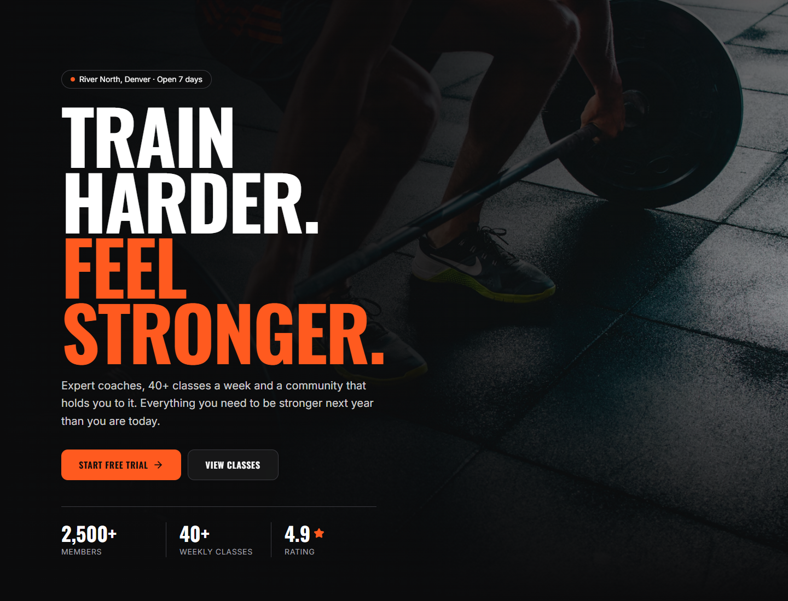
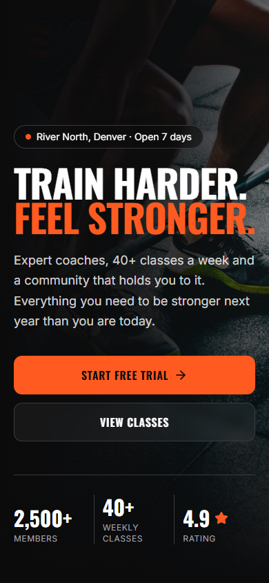
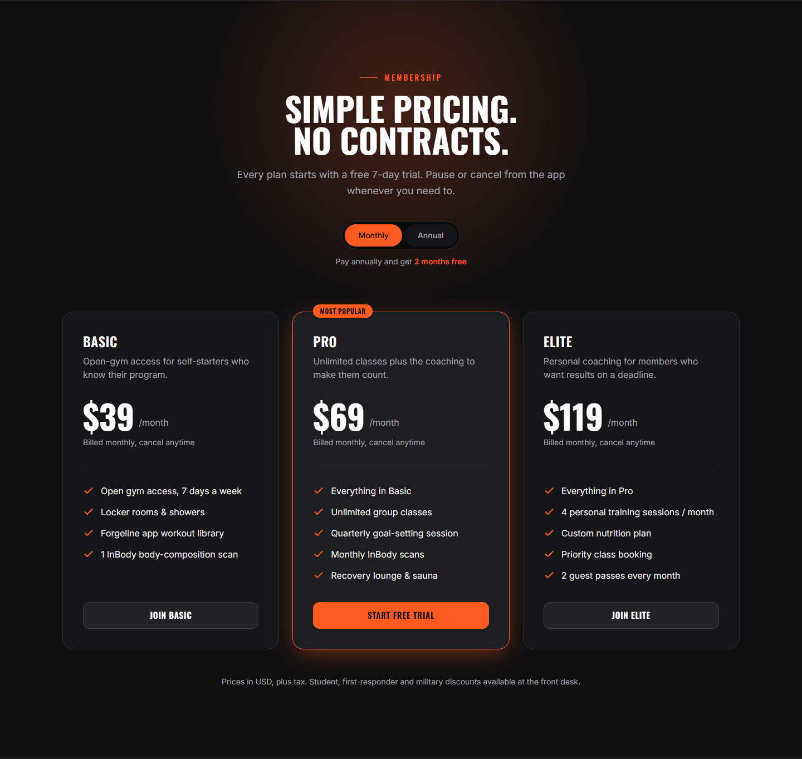
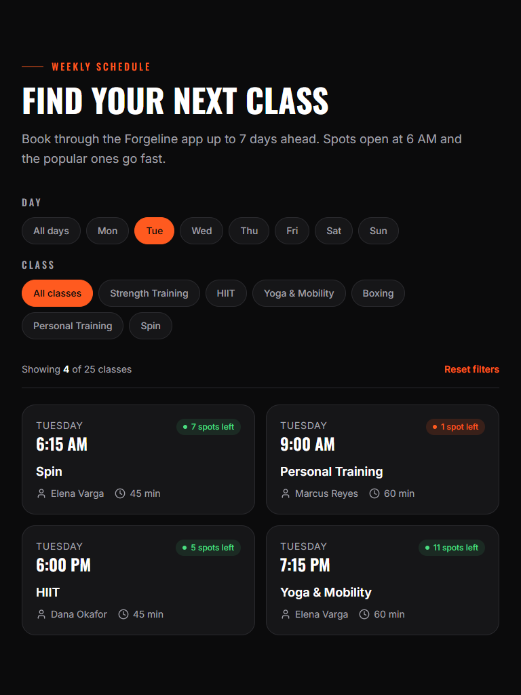

# Forgeline Athletic Club

A single-page marketing site for **Forgeline Athletic Club**, a fictional strength and conditioning gym in Denver, CO. It's a concept project built to show what an agency-quality small-business site looks like: a bold dark design, real copy, working interactions, accessible markup and Lighthouse scores of 99–100.

| Lighthouse (production build) | Performance | Accessibility | Best Practices | SEO |
| ----------------------------- | ----------- | ------------- | -------------- | --- |
| Mobile                        | 99          | 100           | 100            | 100 |
| Desktop                       | 100         | 100           | 100            | 100 |

## Screenshots

| Desktop | Mobile |
| ------- | ------ |
|  |  |
|  |  |

> Add a short screen recording or GIF of the schedule filters, lightbox and signup form here when you present the project.

## Features

- **Sticky header** with smooth-scroll nav, active-section highlight and an accessible mobile menu (Escape to close, focus returned to the toggle)
- **Hero**: full-viewport photo with a dark overlay, a primary and a secondary CTA, and three key stats
- **Testimonials**: three member quotes with 5-star ratings
- **Classes**: six class cards with intensity meters. "See times" filters the schedule to that class.
- **Weekly schedule**: 25 entries, filterable by day and class type. It's a table on desktop and stacked cards on mobile/tablet, opens on today's classes, and has an empty state and a reset button.
- **Pricing**: Basic / Pro / Elite plans with a monthly/annual toggle (annual = 2 months free)
- **Trainers**: four coach cards
- **Transformations gallery**: six images in a native `<dialog>` lightbox (keyboard arrows, Escape, focus restore, scroll lock)
- **Free-trial form**: four fields with inline validation, loading, success and error states, posting to Formspree
- **Contact**: address, hours, phone, email, Instagram, and a lightweight SVG map with a "Get directions" link
- **Footer**, plus a **mobile sticky "Join Now" bar** that appears after the hero and hides while the form is on screen
- SEO: title, meta description, Open Graph/Twitter tags, OG image, favicon, apple-touch-icon, `robots.txt`, `sitemap.xml` and `HealthClub` JSON-LD structured data
- Animations via framer-motion (`LazyMotion`, about 20 kB). They respect `prefers-reduced-motion`.

## Tech stack

- [Vite](https://vite.dev/) + [React](https://react.dev/) + TypeScript
- [Tailwind CSS v4](https://tailwindcss.com/) via `@tailwindcss/vite`. Design tokens live in [`src/index.css`](src/index.css) (`@theme`).
- [lucide-react](https://lucide.dev/) icons (brand icons are inline SVGs in `src/components/ui/SocialIcons.tsx`)
- [framer-motion](https://motion.dev/) for entrance and scroll animations
- [Formspree](https://formspree.io/) for form submissions (no backend)

## Run locally

Requires Node.js 20.19+ (or 22.12+).

```bash
npm install
npm run dev        # http://localhost:5173
```

## Build

```bash
npm run build      # type-checks, then outputs to dist/
npm run preview    # serves the production build at http://localhost:4173
npm run lint       # oxlint
```

## Signup form / Formspree

The free-trial form posts JSON to Formspree when `VITE_FORMSPREE_ID` is set. **Without it, the form simulates a successful submit after one second**, so demos always work.

1. Create a free form at [formspree.io](https://formspree.io/). Your endpoint looks like `https://formspree.io/f/abcdwxyz`.
2. Copy the env example and paste in the ID (the part after `/f/`):
   ```bash
   cp .env.example .env
   # .env
   VITE_FORMSPREE_ID=abcdwxyz
   ```
3. Restart `npm run dev`. On Vercel, add the same variable under **Project → Settings → Environment Variables**, then redeploy.

Submissions include `name`, `email`, `phone`, `goal` and a `_subject` line.

## Deploy to Vercel

No configuration needed; Vercel auto-detects Vite.

1. Push this repo to GitHub.
2. In Vercel, click **Add New → Project** and import the repo. Leave the framework preset as **Vite**, the build command as `npm run build` and the output directory as `dist`.
3. (Optional) Add `VITE_FORMSPREE_ID` as an environment variable.
4. Deploy.

**After deploying**, replace `https://forgeline-athletic-club.vercel.app` with your real domain in [`index.html`](index.html) (canonical, `og:url`, `og:image`, `twitter:image`, JSON-LD), [`public/robots.txt`](public/robots.txt) and [`public/sitemap.xml`](public/sitemap.xml). Social previews need an absolute `og:image` URL.

## Images: where to swap in real photos

All photos are Unsplash images loaded from `images.unsplash.com`. Every one was checked to load. URLs are generated by [`src/lib/images.ts`](src/lib/images.ts), which adds the sizing and `srcset`, so each photo is referenced by its Unsplash photo ID.

| Where | File | What to change |
| ----- | ---- | -------------- |
| Hero background | [`src/sections/Hero.tsx`](src/sections/Hero.tsx) | `HERO_ID` |
| Testimonial avatars | [`src/data/testimonials.ts`](src/data/testimonials.ts) | `avatar` |
| Trainer photos | [`src/data/trainers.ts`](src/data/trainers.ts) | `photo(...)` IDs and alt text |
| Transformations gallery | [`src/data/gallery.ts`](src/data/gallery.ts) | `image(...)` IDs, alt text, captions |
| Signup section photo | [`src/sections/Signup.tsx`](src/sections/Signup.tsx) | `SIGNUP_IMAGE` |
| Social share image | [`public/og-image.jpg`](public/og-image.jpg) | Replace with a 1200×630 JPG |
| Map | [`src/components/ui/MapIllustration.tsx`](src/components/ui/MapIllustration.tsx) | Stylized SVG; swap for a Google Maps/Mapbox iframe if wanted |

**To use your own photos instead of Unsplash:** put them in `public/images/`, and change `unsplash()` / `unsplashSrcSet()` in `src/lib/images.ts` to return local paths (e.g. `/images/${id}.jpg`). Keep the `width`/`height` attributes so there's no layout shift. For a real client, use the client's own photography; the gallery captions describe member results, so they should be real people with consent.

## Project structure

```
src/
├─ components/
│  ├─ layout/      Header, Footer, MobileJoinBar
│  └─ ui/          Button, Card, Container, SectionHeading, Logo, FilterChip,
│                  FormField, StarRating, Reveal, SocialIcons, MapIllustration
├─ sections/       Hero, Testimonials, Classes, Schedule, Pricing, Trainers,
│                  Gallery, Signup, Contact
├─ data/           site (address, hours, contact), nav, classes, schedule,
│                  pricing, trainers, testimonials, gallery
├─ hooks/          useScrolled, useActiveSection, useElementInView
├─ lib/            cn, format, images, signup (validation + submit)
├─ App.tsx
└─ index.css       Tailwind import + design tokens
```

Business details (address, phone, hours, socials) live in [`src/data/site.ts`](src/data/site.ts), so rebranding for a real client mostly means editing the `data/` folder, the tokens in `index.css` and the meta tags in `index.html`.

## Design tokens

| Token | Value | Tailwind |
| ----- | ----- | -------- |
| Base | `#0B0B0C` | `bg-ink` |
| Surface | `#161618` | `bg-surface` |
| Accent | `#FF5A1F` | `bg-accent`, `text-accent` |
| Text | `#FFFFFF` | `text-fg` |
| Muted text | `#A1A1AA` | `text-muted` |
| Display font | Oswald | `font-display` |
| Body font | Inter | `font-sans` |
| Radii | 0.75 / 1.25 / 1.75 rem | `rounded-btn` / `rounded-card` / `rounded-panel` |
| Section spacing | 5.5 / 8 rem | `py-section` / `lg:py-section-lg` |

Accent buttons use dark text on orange (6.3:1 contrast) to meet WCAG AA.

---

Forgeline Athletic Club is a fictional business. Names, address, phone number (555 range) and reviews are invented for demonstration.
